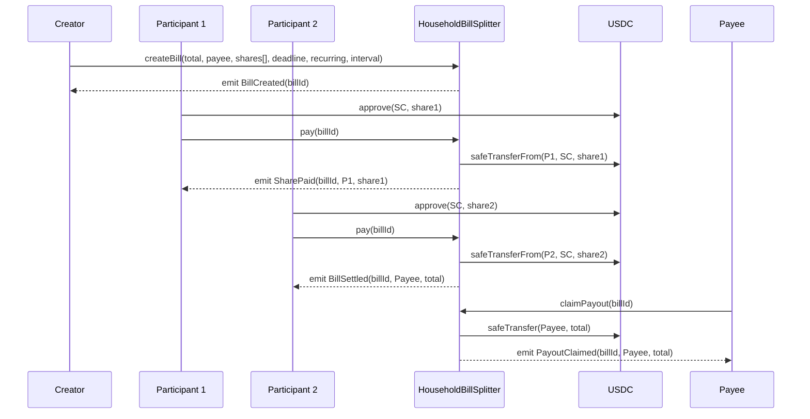
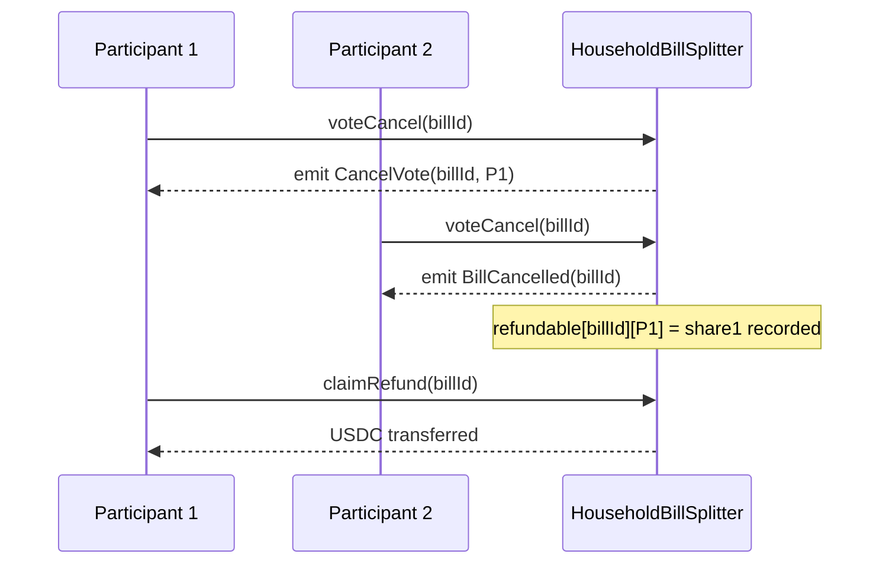

# HouseholdBillSplitter — Contract Design Document

**Status:** Draft  
**Target chain:** Arc Testnet (chain ID 2482, USDC-as-gas) → Arc Mainnet post-validation  
**Language / toolchain:** Solidity 0.8.24, Foundry (forge)  
**Review tracker:**
- [ ] Design review
- [ ] Security review
- [ ] Ops review

---

## 1. Metadata

| Field | Value |
|---|---|
| Contract name | `HouseholdBillSplitter` |
| Chain | Arc Testnet (EVM, Paris EVM target) |
| USDC | ERC-20, 6 decimals, Arc Testnet address from `@/onchain-facts` |
| Solidity | 0.8.24, `evm_version = "paris"` |
| Toolchain | Foundry + OpenZeppelin 5.1.0 |

---

## 2. Action Items (living)

_Empty — populated after each review round._

---

## 3. Goals / Non-Goals

### Goals
- Any address (the "creator") can open a bill for a total USDC amount and assign each participant a share (fixed USDC amount or percentage).
- Multiple participants pay their individual share directly into the contract.
- When the bill reaches 100 % funded, the full amount is marked claimable for the payee address set at creation (landlord, service provider, or the creator themselves), and the payee claims via `claimPayout()`.
- Overpayments (a participant sends too much) are automatically refunded to the sender.
- Every bill has an optional deadline; unpaid shares after the deadline are publicly visible as "late".
- Bills can be cancelled by a quorum of co-signers (multi-approval cancel), with all already-paid shares refunded to each payer.
- Bills can be created as recurring (monthly), which auto-opens the next period's bill upon full settlement.
- A factory pattern: a single `HouseholdBillSplitter` contract manages all bills (keyed by `billId`), keeping all USDC in one audited address.

### Non-Goals
- Cross-chain settlement (all funds stay on Arc).
- Governance token or protocol fee — no platform cut taken.
- Fiat on-ramp (users supply USDC directly).
- NFT share certificates.
- Ability to reassign a share to a different address after bill creation.

---

## 4. Requirements

### Functional
1. Creator opens a bill: total amount, payee address, list of participants with shares (percentage OR fixed), optional deadline, optional recurrence interval.
2. Percentage-based bills must sum to exactly 100 %. Fixed-amount bills must sum to exactly the total amount.
3. Each participant calls `pay(billId)` and transfers exactly their share via ERC-20 `transferFrom`.
4. If a participant sends more than their share, the surplus is refunded in the same transaction.
5. On full funding: payout becomes claimable by the payee; the payee later calls `claimPayout()` to pull USDC.
6. If `recurring == true` and the recurrence interval > 0, a new bill with identical parameters is automatically opened with `deadline = block.timestamp + interval`.
7. Cancel: requires `cancelThreshold` (≥ 1, ≤ participantCount) approvals. Any participant or the creator may submit a cancel vote. Once threshold is reached, all paid shares are refunded and the bill is marked Cancelled.
8. Late payment: if `block.timestamp > deadline` (and `deadline != 0`) and a share is unpaid, `isLate(billId, participant)` returns `true`.
9. The owner can call `recoverToken(token, to)` to sweep only surplus tokens above `_totalReserved`; active bill funds and unclaimed payouts/refunds are protected by the `_totalReserved` floor.

### Security
- No path lets a non-participant pay into a bill.
- No path lets any address drain funds belonging to another bill.
- Full funding marks payout as claimable for the payee; settlement is not blocked by payee transfer behavior, and payee pulls funds via `claimPayout()`.
- Cancel refunds MUST be pull-based (payers call `claimRefund`) to avoid DoS from a malicious ERC-20 receiver.
- Re-entrancy: CEI + `nonReentrant` on all state-mutating external USDC interactions.
- Integer math: no unchecked arithmetic on token amounts.
- Payee address MUST be validated non-zero at creation.

---

## 5. Terminology & Actors

| Term | Definition |
|---|---|
| Bill | A single payment obligation with a total amount, participant split, and payee. |
| Creator | The address that calls `createBill`. Sets the rules; does NOT need to be a participant. |
| Participant | An address assigned a share in a bill; the only address authorised to pay that share. |
| Payee | The address that receives the full amount on full settlement (landlord, utility, or creator). |
| Share | A participant's portion — either a fixed USDC amount or a percentage basis point (0–10 000). |
| Deadline | An optional Unix timestamp; shares unpaid after it are flagged late. |
| CancelThreshold | Minimum number of cancel-approval votes needed to void the bill and trigger refunds. |
| Recurrence interval | Seconds between the end of one recurring period and the start of the next. Zero = non-recurring. |

### Actor trust model

| Actor | On/Off-chain | Trust level | Powers |
|---|---|---|---|
| Creator | On-chain | Semi-trusted | Creates bills, sets payee + shares + cancel threshold. Cannot withdraw funds after creation. |
| Participant | On-chain | Semi-trusted | Pays own share; votes to cancel; claims refund after cancel. |
| Payee | On-chain | Untrusted | Receives USDC on full funding. Must be an EOA or a contract that can receive ERC-20. |
| Contract (self) | On-chain | Trusted | Holds USDC in escrow; enforces rules; forwards on settlement. |
| USDC token | On-chain | Trusted | Circle-issued ERC-20; used via `SafeERC20`. |

---

## 6. Language / Runtime

- **Solidity 0.8.24** — built-in overflow checks, custom errors (gas-efficient reverts), `block.timestamp` for deadlines.
- **EVM version: Paris** (Arc Testnet foundry.toml constraint — no Cancun opcodes).
- **OpenZeppelin 5.1.0** (`ReentrancyGuard`, `SafeERC20`, `Ownable2Step`).
- No `delegatecall`, no proxy — the contract is intentionally non-upgradeable to maximise trust for fund custody.

---

## 7. Transaction & Execution Model

All state transitions are atomic. The re-entry surface is the `pay()` function (calls `safeTransferFrom`) and payout/refund claims (`claimPayout()` / `claimRefund()` call `safeTransfer`). CEI ordering is applied throughout: state is updated before any external token transfer. `nonReentrant` is applied on `pay()`, `claimPayout()`, and `claimRefund()`.

---

## 8. Chain Standards & Interfaces

- **USDC**: standard ERC-20 with 6 decimals.  
- `SafeERC20.safeTransfer` / `safeTransferFrom` for all token moves.  
- No NFT, no signature-based auth, no Permit2 (direct `transferFrom` after user approval is simpler and avoids off-chain signing complexity for a household app).

---

## 9. Architecture Overview

### Component diagram

```mermaid
graph TD
    Creator -->|createBill| HSB[HouseholdBillSplitter]
    Participant -->|approve USDC + pay| HSB
    Payee -->|claimPayout()| HSB
    HSB -->|safeTransfer on claimPayout| Payee
    HSB -->|safeTransfer on claimRefund| Participant
    HSB -->|reads| USDC[USDC ERC-20]
```

### Sequence: happy-path bill settlement



### Sequence: cancel with refunds



### Flow of funds

| Step | Who moves what | Invariant |
|---|---|---|
| `pay()` called | Participant → contract (their share amount) | `contractUSDCBalance += shareAmount` |
| Last share paid | Contract records payout claimable for Payee | Funds stay escrowed until claimed |
| `voteCancel()` threshold reached | Contract records refundable amounts | Sum of refundable = sum already paid to this bill |
| `claimRefund()` called | Contract → Participant (their paid amount) | Refundable amount zeroed before transfer |

**Resting-state invariant:** the contract may hold USDC for `Active` bills and for `Settled` bills with unclaimed payouts. Once `claimPayout()` and all refunds are claimed, no residual bill funds remain.

---

## 10. Contract Design

### Roles

| Role | Holder | Permissions | Blast radius if compromised |
|---|---|---|---|
| Creator | Address that called `createBill` | Set all bill params at creation; no post-creation power | Can set a malicious payee address at creation time only |
| Participant | Addresses in `shares[]` | Pay own share; vote to cancel; claim refund | Can withhold payment (no forced payment) |
| Payee | Any address set at creation | Claim full settled amount via `claimPayout()` | If payee cannot receive tokens, only payee claim fails; settlement itself is unaffected |
| Owner | Deployer (`Ownable2Step`) | Two-step ownership transfer; `recoverToken(token,to)` can sweep only surplus above `_totalReserved` | Compromised owner can redirect surplus/accidental tokens, but cannot seize reserved bill funds |

### Storage layout

```solidity
enum BillStatus { Active, Settled, Cancelled }

struct Share {
    address participant;
    uint256 amount;       // always stored in USDC units (converted from pct at creation)
    bool paid;
}

struct Bill {
    address creator;
    address payee;
    uint256 totalAmount;
    uint256 amountPaid;
    BillStatus status;
    uint256 deadline;      // 0 = no deadline
    bool recurring;
    uint256 recurInterval; // seconds; 0 = non-recurring
    uint8 cancelThreshold;
    uint8 cancelVotes;
    Share[] shares;
}

// State variables
uint256 public billCount;
mapping(uint256 => Bill) private _bills;
mapping(uint256 => mapping(address => bool)) public cancelVoted;
mapping(uint256 => mapping(address => uint256)) public refundable;
address public immutable usdc;
```

### Modifiers

| Modifier | Guard |
|---|---|
| `billActive(id)` | `_bills[id].status == Active` |
| `onlyParticipant(id)` | msg.sender has a share in bill `id` |

### Functions (write)

| Function | Caller | State mutated | Events | Revert conditions |
|---|---|---|---|---|
| `createBill(total, payee, participants[], amounts[], deadline, recurring, interval, cancelThreshold)` | Anyone | Inserts Bill; increments billCount | `BillCreated` | total==0, payee==0x0, participants empty, amounts don't sum to total, cancelThreshold > participants.length, interval==0 when recurring==true |
| `pay(billId)` | Participant only | Updates contribution and amountPaid; on full: sets status=Settled and records payout claimable; if recurring: creates new bill | `SharePaid`, `BillSettled`, `BillCreated` (recurring) | Bill not Active, msg.sender has no share, share already paid, transferFrom fails |
| `voteCancel(billId)` | Participant or creator | Increments cancelVotes, marks address voted; on threshold: sets status=Cancelled, records refundables | `CancelVote`, `BillCancelled` | Bill not Active, already voted |
| `claimRefund(billId)` | Participant | Zeros refundable[billId][msg.sender]; transfers USDC | `RefundClaimed` | refundable amount == 0 |

### Events

| Event | Params | When |
|---|---|---|
| `BillCreated` | `billId, creator, payee, totalAmount, deadline, recurring` | New bill opened |
| `SharePaid` | `billId, participant, amount` | A participant's share is paid |
| `BillSettled` | `billId, payee, totalAmount` | All shares paid, payout marked claimable |
| `CancelVote` | `billId, voter` | A cancel vote recorded |
| `BillCancelled` | `billId` | Cancel threshold reached |
| `RefundClaimed` | `billId, participant, amount` | Participant pulls their refund |

---

## 11. Specification Tables

### 11.1 Bill lifecycle principles
1. A bill's `totalAmount` is immutable after creation.
2. Shares sum = `totalAmount`; this is enforced at creation and never changes.
3. A bill in `Settled` or `Cancelled` state accepts no further payments or votes.
4. On settlement, the contract records payout claimable; payee later pulls funds via `claimPayout()`.
5. Refunds are pull-based: the contract records the amount; the participant initiates the transfer.

### 11.2 Bill creation

| Functionality | Restriction | Event | Audit/Verify Note |
|---|---|---|---|
| Create fixed-amount bill | Anyone, sum(amounts)==total | `BillCreated` | Enforce sum check |
| Create percentage bill | Anyone, sum(pct)==10000 | `BillCreated` | Convert pct to amounts at creation; store amounts |
| Set deadline | Creator at creation | — | deadline=0 means no deadline |
| Set recurring | Creator at creation, interval>0 | — | interval=0 and recurring=true → revert |

### 11.3 Payment

| Functionality | Restriction | Event | Audit/Verify Note |
|---|---|---|---|
| Pay own share | Participant, bill Active, share not yet paid | `SharePaid` | Use CEI; nonReentrant |
| Overpayment refund | Auto on same tx if user approves > share | — | Take exact share; remainder stays in user wallet (no pull needed since we only pull exact amount) |
| Final payment triggers settlement | Participant who pays the last share | `BillSettled` | Payout is recorded as claimable; payee later pulls via `claimPayout()` |

### 11.4 Cancel & refund

| Functionality | Restriction | Event | Audit/Verify Note |
|---|---|---|---|
| Vote to cancel | Participant or creator, bill Active, not yet voted | `CancelVote` | |
| Auto-cancel on threshold | When cancelVotes >= cancelThreshold | `BillCancelled` | Record refundables before status change |
| Claim refund | Participant, bill Cancelled, refundable > 0 | `RefundClaimed` | Zero refundable before transfer (CEI) |

---

## 12. Deployment & Initialization

- **Constructor**: takes `address usdc_` and sets immutable `usdc`. No proxy — the contract is immutable post-deploy.
- **Constructor validation**: revert if `usdc_ == address(0)`.
- **CREATE1** (normal deploy) — address is non-deterministic but that is fine; users interact via the shared contract, not a per-user deploy.
- **Post-deploy init**: none required; `billCount` starts at 0.
- **Key at genesis**: deployer holds owner role and should be a multisig for mainnet deployments; owner can only recover surplus via `recoverToken`, not funds tracked in `_totalReserved`.

---

## 13. Upgradeability

**Non-upgradeable.** This is a deliberate trust decision: users must be able to verify that the contract handling their rent money cannot be silently replaced. Migration path: deploy a new version and ask bill creators to migrate — all existing bills complete on the old contract, new bills use the new one. No proxy, no `initialize`, no `_disableInitializers()`.

---

## 14. Key Management & Signing

- No off-chain signing in this contract (no EIP-712, no Permit2).
- The only "privileged" key is the owner; in addition to two-step ownership transfer it can call `recoverToken` to sweep surplus balances above `_totalReserved`. For mainnet, this owner should be a multisig.
- USDC `approve` is done by the user in their wallet before calling `pay()`.

---

## 15. Security Considerations

| Vulnerability | Applicable? | Mitigation |
|---|---|---|
| Reentrancy | Yes — `pay()` calls `safeTransferFrom` then `safeTransfer`; `claimRefund()` calls `safeTransfer` | CEI ordering enforced; `nonReentrant` on both functions |
| Access control | Yes — pay, cancel, refund restricted to participants | `onlyParticipant` modifier; share existence check |
| Integer overflow/underflow | Solidity 0.8 checked | No `unchecked` blocks on token amounts |
| Unchecked external call | Yes — USDC transfer | `SafeERC20.safeTransfer` / `safeTransferFrom`; reverts propagate |
| Fee-on-transfer tokens | No — only Circle USDC used | N/A; USDC is not fee-on-transfer |
| Signature replay | No off-chain signing | N/A |
| Front-running / MEV | Low — no price oracle, fixed amounts | No impact; shares are fixed at creation |
| Flash-loan / oracle manipulation | No oracle | N/A |
| Denial of service | Yes — claim functions involve external token transfer | Pull-based claims (`claimPayout`, `claimRefund`) isolate transfer failures to the caller; bill settlement itself does not push to payee |
| Payee-reverts DoS | Reduced — if payee cannot receive tokens, settlement still succeeds | Only `claimPayout()` by the payee reverts; participants are not blocked from settling the bill |
| Delegatecall / proxy | No | N/A |
| Timestamp dependence | Yes — deadline uses `block.timestamp` | Used for informational lateness only; no value extraction possible from block-timestamp manipulation |
| Approval persistence | Low — `transferFrom` pulls exact share | Users approve only what they owe; no dangling max-approvals required by the contract |
| Centralization risk | Moderate — owner can sweep only surplus | `recoverToken` is constrained by `_totalReserved`; active bill funds remain protected. Use multisig owner on mainnet. |
| Duplicate participant | Yes — same address listed twice inflates shares | Enforce uniqueness of participant addresses at creation |
| Cancel threshold = 0 | Yes — would allow instant self-cancel | Revert if `cancelThreshold == 0` |
| Recurring bill with zero interval | Yes | Revert if `recurring == true && recurInterval == 0` |
| Bill with no participants | Yes | Revert if `participants.length == 0` |

---

## 16. Trust Model & Threat Analysis

| Privileged actor | Max damage if key compromised | Mitigation | Detection |
|---|---|---|---|
| Creator | Can set malicious payee address — all funds go to attacker on settlement | Creator cannot change payee post-creation; participants verify payee before paying | `BillCreated` event indexes payee |
| Participant | Can withhold their share (bill stays partially funded) | Cancel mechanism allows group to abort and get refunds | `isLate()` visibility; cancel vote |
| Payee | Can be a contract that cannot receive token transfer during payout claim | Creator must vet payee address; redirect and quorum paths can update payee for unclaimed settled payouts | Failed `claimPayout` attempts visible on-chain |
| Owner (deployer) | Can transfer ownership and sweep surplus tokens via `recoverToken` | `_totalReserved` protects active-bill/unclaimed funds; use multisig owner to reduce key risk | `OwnershipTransferStarted` event, `TokenRecovered` event |

---

## 17. Emergency Response & Circuit Breakers

**No pause mechanism.** Pause adds a trusted role that can freeze user funds — inappropriate for a household app where trust is already strained. Instead:

- **Cancel-with-quorum** is the circuit breaker: if the payee is known bad or the bill parameters are wrong, participants vote to cancel and reclaim funds.
- **Owner has a constrained rescue function.** `recoverToken(token, to)` can sweep only surplus above `_totalReserved`; it cannot touch active bill funds, unclaimed refunds, or unclaimed settled payouts.

---

## 18. Failure Scenarios

| Scenario | What happens | How contract stays safe |
|---|---|---|
| Participant never pays | Bill stays Active; `isLate()` returns true past deadline | Other participants can vote to cancel and reclaim; no one is locked |
| Payee address reverts on transfer | `pay()` on last share reverts; bill stays Active at 99 % | Participants cancel and refund; creator should set a different payee |
| Participant sends bill to 100 % and payee call fails | Entire `pay()` reverts atomically | Contract state rolls back; no partial settlement |
| Creator opens bill with wrong total | Creator cannot fix post-creation | Cancel + new bill (cancel quorum needed) |
| Recurring bill: new bill opens but participants ignore it | New bill sits Active until deadline | Cancel mechanism available on new bill |

---

## 19. Priorities & Tradeoffs

| Decision | Tradeoff | Rationale |
|---|---|---|
| Non-upgradeable | Cannot fix bugs in deployed contract | Maximises fund-custody trust for end users who are non-technical |
| Push payout on settlement (not pull) | Malicious payee contract can block settlement | Matches real-world UX: landlord gets paid immediately; pull adds friction |
| Pull refunds on cancel | Extra tx for participants | Prevents DoS from malicious ERC-20 receiver; USDC is well-behaved but pattern is safer |
| Single contract (factory pattern) | Larger attack surface; all bills in one contract | Cheaper gas per bill; one audited address; simpler link-sharing |
| No pause | Cannot freeze a compromised bill | Cancel quorum is sufficient; pause-admin key is itself a risk |
| Percentage-to-amount conversion at creation | Rounding dust possible | Accumulate rounding surplus in the final participant's share; ensures sum == total |

---

## 20. Testing Strategy

- **Unit tests (Foundry):** happy path, revert paths, fuzz on amount arithmetic, at least one invariant (`sum(paid shares) == amountPaid`).
- **Slither static analysis:** run pre-deploy with `--json`.
- **Fork tests:** verify USDC `transferFrom` and `safeTransfer` against real Arc Testnet USDC.
- **Coverage target:** 90 % branch coverage minimum.
- **Run command:** `forge test --gas-report`

---

## 21. Third-party Libraries

| Library | Version | Dependency? | Why | Audited? |
|---|---|---|---|---|
| OpenZeppelin Contracts | 5.1.0 | Yes (pinned) | `ReentrancyGuard`, `SafeERC20`, `Ownable2Step` | Yes |

---

## 22. Monitoring & Alerting

| Event | Threshold | Severity | Playbook |
|---|---|---|---|
| `BillCreated` with payee = known EOA | — | Info | Track open bills |
| `BillSettled` | — | Info | Confirm payee received funds |
| `BillCancelled` | — | Warning | Investigate if recurring bill repeatedly cancelled |
| `RefundClaimed` | — | Info | Normal |
| No `BillSettled` after deadline + 7 days | Per bill | Warning | Prompt participants to cancel |

---

## 23. Cross-Functional Stakeholders

| Reviewer | Owns |
|---|---|
| Security | §15 vulnerability table, §16 threat model |
| Product | §3 goals, §19 tradeoffs |
| Ops | §12 deployment, §17 emergency |
| Compliance | USDC usage, no custodial key risk |

---

## 24. Message Encoding

N/A — single-chain contract, no cross-chain messaging.

---

## 25. Types & Enums

See §10 Storage layout. `BillStatus` enum and `Share` struct cross the ABI boundary as return values.

---

## 26. Common Patterns / Worked Examples

### Example 1: Rent bill (fixed amounts)

1. Creator calls `createBill(3000_000000, landlord, [alice, bob, charlie], [1000_000000, 1000_000000, 1000_000000], deadline=nextMonth, recurring=true, interval=30days, cancelThreshold=2)`.
2. Contract stores Bill #0: total=3000 USDC, payee=landlord, 3 shares of 1000 USDC each.
3. Alice approves 1000 USDC, calls `pay(0)`. Contract pulls 1000 USDC. `amountPaid=1000`.
4. Bob approves and pays. `amountPaid=2000`.
5. Charlie is late — `isLate(0, charlie)` returns `true` after deadline.
6. Charlie eventually pays. `amountPaid=3000 == total`. Contract calls `safeTransfer(landlord, 3000 USDC)`. Emits `BillSettled`.
7. New Bill #1 is auto-created with same params, `deadline = block.timestamp + 30 days`.

### Example 2: Cancel and refund

1. Bill #2 exists: 500 USDC total, 2 participants (dave=250, eve=250), cancelThreshold=1.
2. Dave pays 250 USDC. `amountPaid=250`.
3. Eve discovers the payee address is wrong. She calls `voteCancel(2)`. cancelVotes=1 >= threshold=1.
4. Bill marked Cancelled. `refundable[2][dave]=250`.
5. Dave calls `claimRefund(2)`. Contract zeros `refundable[2][dave]`, transfers 250 USDC to Dave.
